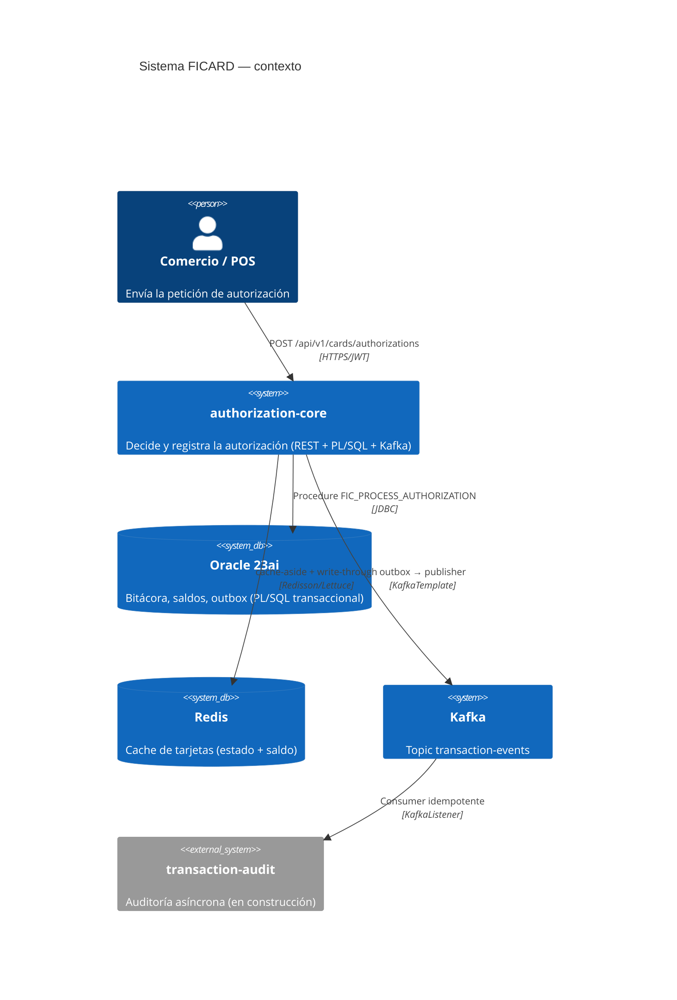

# FICARD — Core de Autorización Transaccional

Prototipo de un **core de autorización de tarjetas** (e-commerce/POS): un
microservicio que recibe peticiones de autorización, decide si la transacción
se **APRUEBA** o se **DECLINA** (fondos, bloqueos, vigencia), registra la
decisión con atomicidad transaccional en Oracle vía **PL/SQL**, y publica un
evento asíncrono a Kafka para la auditoría — todo con cache Redis y seguridad
JWT.

> Prueba técnica — Java 21 · Spring Boot 3.4.5 · Oracle 23ai (PL/SQL) · Redis · Kafka · JWT

---

## Arquitectura (nivel C4 — Contexto)



Diagramas completos (C4 niveles 1, 2 y 3): [`docs/architecture/c4.md`](docs/architecture/c4.md)
Decisiones de diseño: [`docs/adr/`](docs/adr/)

---

## Stack

| Componente | Tecnología | Nota |
|---|---|---|
| Lenguaje | **Java 21** (Temurin) | records, switch patterns |
| Framework | **Spring Boot 3.4.5** (multi-módulo Maven) | |
| Web/REST | spring-boot-starter-web + **springdoc** 2.8.6 (Swagger UI) | |
| Seguridad | spring-security-oauth2-resource-server — **JWT HS256** | secret compartido; token dev solo perfil `local` |
| Base de datos | **Oracle 23ai** (container `gvenzl/oracle-free`) + lógica en **stored procedure PL/SQL** | decisión de fondos SIEMPRE dentro del procedure |
| Acceso a datos | spring-boot-starter-jdbc (Plain JDBC / CallableStatement) | sin JPA a propósito: control fino del SQL |
| Cache | **Redis 7** (Lettuce) | cache-aside en lectura + **write-through** al cobro |
| Eventos | **Kafka 4.0** (KRaft single-node) | topic `transaction-events`, 3 particiones, key=`transactionId` |
| Patrón de entrega | **Transactional Outbox** | `event_outbox` (PENDING → SENT) + scheduler de reintentos (10 s) |

---

## Estructura del proyecto

```
fincard-auth/
├── pom.xml                          ← agregador multi-módulo
├── authorization-core/              ← microservicio de autorización (puerto 8080)
│   ├── src/main/java/com/fincard/core/
│   │   ├── api/                     ← controllers (autorización, status, dev-token)
│   │   ├── dto/                     ← DTOs REST + validaciones declarativas
│   │   ├── service/                 ← orquestación (AuthorizationService)
│   │   ├── repository/              ← JDBC (CardRepository, AuthorizationDao, EventOutboxDao)
│   │   ├── cache/                   ← RedisCardCacheService (read-through / write-through)
│   │   ├── kafka/                   ← TransactionEventMessage + TransactionEventService (outbox publisher)
│   │   ├── config/                  ← SecurityConfig (JWT), KafkaConfig (topic)
│   │   ├── advice/                  ← GlobalExceptionHandler (400/404/405/500 homogéneos)
│   │   └── model/                   ← enums CardStatus/CardType/DeclineCode, CardSnapshot
│   ├── src/test/java/               ← 14 tests (unit + integración MockMvc)
│   └── sql → ver raíz: sql/
├── transaction-audit/               ← consumidor de auditoría (puerto 8081) ✅
│   └── src/test/java/               ← 4 tests (idempotencia)
├── docs/
│   ├── openapi/authorization-api.yaml   ← contrato REST del core (fuente de verdad, design-first)
│   ├── openapi/audit-api.yaml           ← contrato REST del audit
│   ├── events/transaction-events.md     ← contrato del evento Kafka
│   ├── architecture/c4.md               ← C4 niveles 1-3
│   └── adr/                             ← decisiones de diseño (ADRs)
└── sql/
    ├── 01_schema.sql                    ← DDL: cards, transactions, movements, event_outbox
    ├── 02_stored_procedures.sql.sql     ← procedure FIC_PROCESS_AUTHORIZATION
    ├── 03_audit_schema.sql              ← DDL audit_transactions
    └── 04_seed.sql                      ← tarjetas de los 6 escenarios
```

Todos los artefactos suben con el compose (ver abajo): `docker compose up -d`
levanta TODO — oracle+redis+kafka con auto-init del schema/seed vía
`/container-entrypoint-initdb.d` y los 2 microservicios con `service_healthy`.

---

## Cómo levantar todo (local)

**La vía principal:** `docker compose up -d` (trae su infraestructura + los 2 servicios con auto-init y `service_healthy`)

Pero para desarrollo iterativo puedes hacerlo por partes:

### 1. Infraestructura (Docker)

```bash
# Oracle 23ai (crear y aplicar schema)
docker run -d --name fincard-oracle -p 1521:1521 -e ORACLE_PASSWORD=admin gvenzl/oracle-free:23.7-slim-faststart
# ← aplicar: sql/01_schema.sql + sql/02_stored_procedures.sql.sql + seed (usuario ficard/ficard @ FREEPDB1)

# Redis
docker run -d --name fincard-redis -p 6379:6379 redis:7-alpine

# Kafka (KRaft, single-node)
docker run -d --name kafka -p 9092:9092 apache/kafka:4.0.0
```

### 2. Servicios

- **Desde IDE:** correr `AuthorizationCoreApplication` (el perfil `local` ya está en el yml)
- **Desde terminal:** `mvn -f pom.xml -pl authorization-core spring-boot:run`

### 3. El flujo completo (`curl`)

```bash
# 1. Token dev (perfil local; en prod lo emite un IdP real)
curl -X POST http://localhost:8080/api/v1/dev/tokens

# 2. Autorizar una compra (APPROVED)
curl -X POST http://localhost:8080/api/v1/cards/authorizations \
  -H "Content-Type: application/json" \
  -H "Authorization: Bearer <accessToken>" \
  -d '{"cardNumber":"4539148803436467","cardExpiry":"10/29","amount":100.00,
       "currency":"USD","merchantId":"MERCH-001","merchantName":"Tienda Demo"}'
```

UI de la API: **http://localhost:8080/swagger-ui.html** (Swagger ABIERTO; los endpoints de negocio piden JWT — usa el botón *Authorize*).

### 4. Verificación de las evidencias

```bash
# Bitácora + outbox (en Oracle, usuario ficard)
SELECT decision, response_code, decline_code, amount FROM transactions ORDER BY created_at;
SELECT outbox_id, transaction_id, status, TO_CHAR(sent_at) FROM event_outbox ORDER BY outbox_id;

# El evento en Kafka
docker exec kafka /opt/kafka/bin/kafka-console-consumer.sh \
  --bootstrap-server localhost:9092 --topic transaction-events --from-beginning --max-messages 5

# El cache en Redis
docker exec fincard-redis redis-cli keys "fincard:card:*"
docker exec fincard-redis redis-cli get "fincard:card:4539148803436467"
```

---

## Tarjetas del seed (para probar los 6 escenarios)

| PAN | Tipo/Status | Saldo | Escenario que dispara |
|---|---|---|---|
| `4539148803436467` | DEBIT ACTIVE | 1850.00 | **APPROVED** (00) |
| `5211000000001234` | DEBIT ACTIVE | 42.50 | **INSUFFICIENT_FUNDS** (51) con monto > saldo |
| `4111111111111111` | DEBIT BLOCKED | 500.00 | **CARD_BLOCKED** (07) — check optimista en Java |
| `4024007196559937` | DEBIT ACTIVE (exp 01/25) | 1000.00 | **CARD_EXPIRED** (54) — estado derivado |
| `3782822463100051` | CREDIT ACTIVE | 3472.50 | semántica crédito |

Condiciones de contrato sobre el request: `cardNumber` 13-19 dígitos, `cardExpiry` MM/YY, `amount >= 0.01`, `currency` ISO-4217 (3 letras), `merchantId` obligatorio (<-40), `merchantName` opcional (<-120).

---

## Decisiones de diseño clave (resumen; detalle en ADRs)

| # | Decisión | ADR |
|---|---|---|
| 1 | Las **declinaciones de negocio son HTTP 200** con `decision=DECLINED` + `declineCode` (los 4xx/5xx solo para problemas de contrato/transporte) | [ADR-0001](docs/adr/ADR-0001-declines-de-negocio-http-200.md) |
| 2 | La **decisión final de fondos vive SOLO en el procedure PL/SQL** con `SELECT ... FOR UPDATE` (anti doble-gasto); Java solo hace checks optimistas | [ADR-0002](docs/adr/ADR-0002-fondos-en-el-procedure.md) |
| 3 | **Transactional Outbox** para el evento Kafka: se persiste el evento en la MISMA transacción (outbox) y un scheduler lo publica; at-least-once + consumidor idempotente | [ADR-0003](docs/adr/ADR-0003-transactional-outbox.md) |
| 4 | **Redis cache-aside en lectura + write-through al cobro** (el cargo llega con el saldo del OUT del procedure); conocido TTL 180 s y degradación elegante si Kafka/Redis caen | [ADR-0004](docs/adr/ADR-0004-redis-cache-aside-write-through.md) |
| 5 | **JWT HS256 con resource-server** (api clamado OAuth2): el core NO emite tokens; en dev un emisor solo-perfil-local acelera la prueba | [ADR-0005](docs/adr/ADR-0005-jwt-resource-server-hs256.md) |
| 6 | Declines tempranos (BLOCKED/EXPIRED) **no se bitacoran** en Oracle hoy — trade-off aceptado, corrección definida | [ADR-0006](docs/adr/ADR-0006-early-declines-sin-bitacora.md) |

## Semántica de códigos (ISO 8583-inspired)

| `responseCode` | Significado | ¿Dónde decide? |
|---|---|---|
| `00` | APPROVED | procedure (fondo al saldo bajo lock) |
| `51` | INSUFFICIENT_FUNDS | procedure (decisión final) |
| `07` | CARD_BLOCKED | Java (check optimista pre-procedure) |
| `54` | CARD_EXPIRED | Java (estado derivado de `card_expiry`) |
| `14` | CARD_NOT_FOUND (solo POST; el GET usa 404) | Java |
| `96` | SYSTEM_ERROR | procesamiento del procedure |

---


## ~18 tests verdes

El proyecto está verificado con una suite Runnable (`mvn -B test` en ambos módulos): 6 del service (early-declines, emisión solo-APPROVED, cache-aside escritura del cobro con saldo fresco), 5 del publisher (outbox resiliente: Kafka caído PENDING-lento, retry rescate, payload JSON contrato), 4 del consumer (idempotencia doble-capa, re-kick offset), y 3 de integración MockMvc/Security/validación.

---

## Producción: escalabilidad, resiliencia y observabilidad

Lo que cambia si esto va a producción real (K8s, CI/CD, etc. — la sección E del enunciado).

### Escalabilidad

| Componente | Estrategia |
|---|---|
| `authorization-core` | **Stateless por diseño** (JWT stateless, sin sesión) → escala horizontal: N réplicas detrás de un Service/LB. El lock pesimista (`SELECT ... FOR UPDATE`) se resuelve EN Oracle: las réplicas compiten por la fila de la tarjeta y el bloqueo garantiza serialización correcta |
| Outbox scheduler | riesgo conocido de multi-réplica: 2 réplicas con scheduler enviarían el mismo evento. Solución elegible: (a) **Kubernetes leader election** (solo 1 réplica pone el scheduler activo), (b) `FOR UPDATE SKIP LOCKED` en `listPending` (los schedulers se reparten el backlog sin duplicar), (c) tolerar duplicados: el consumer del audit ya es idempotente, el coste es solo re-envío |
| `transaction-audit` | Consumer groups de Kafka: 2+ réplicas del servicio reparten particiones del topic automáticamente (rebalance nativo). Escala lineal con particiones |
| Oracle | Read-only queries por caché de Redis ya alivian: el hit-rate objetivo > 90% reduce QPS a la DB del factor 10. En producción cloud: Oracle Autonomous DB / OCI con connection pooling (Hikari: máx pool = (cores * 2) por pod) |

### Resiliencia

| Fallo | Comportamiento HOY (verificado en tests) | Complemento prod |
|---|---|---|
| Kafka caído | el evento persiste como `PENDING` en outbox; el scheduler reintenta cada 10 s → **cero pérdida garantizada** (`TransactionEventServiceTest.publish_kafkaDown_keepsPending`) | retries exponenciales con backoff + DLQ topic tras N intentos |
| Oracle caído (breve) | core responde 5xx canónico; el caller reintenta (la autorización es idempotente **desde el lado del negocio**: cada request crea un `transactionId` NUEVO) | Resilience4j circuit-breaker sobre JDBC; healthcheck guided por el K8s readiness probe |
| Redis caído | cache-aside degrada a Oracle (la lectura pasa directo a DB — latencia sube, no falla) | timeout corto en Redis (~5 ms) para no arrastrar el p95 |
| Duplicado de evento | consumer idempotente doble-capa: check-then-insert + `UNIQUE(transaction_id)` de BD (`AuditConsumerTest`) | ya blindado en prod |
| Consumo fallido | el listener relanza → offset NO avanza → Kafka re-entrega (at-least-once) | DLQ tras N reintentos para no envenenar la partición |

### Observabilidad

- **Health checks** (ya implementados): `/actuator/health` — el compose ya sondea `health` en el arranque; en K8s se separan liveness/readiness
- **Metrics**: Micrometer + `/actuator/prometheus` → Prometheus + Grafana. Métricas clave por definir: `authorization_decisions_total{decision=...}` (ratio approve/declines por Merchant Category Code), `outbox_pending_count` (backlog = salud del event pipeline), Hikari pool acquires, cache hit-rate Redis, consumer lag del audit
- **Logs estructurados JSON** con `transactionId` como correlation-id (ya viaja en cada log del `AuthorizationService`) → ingesta Loki/ELK, búsqueda end-to-end "dame toda la vida de la txn X"
- **Traces** OpenTelemetry (W3C traceparent) core → Oracle → Kafka → audit: la decisión final y su evento comparten trace-id

### CI/CD (GitHub Actions, bosquejo)

```yaml
# .github/workflows/ci.yml
name: ci
on: [pull_request]
jobs:
  build-test:
    runs-on: ubuntu-latest
    steps:
      - uses: actions/checkout@v4
      - uses: actions/setup-java@v4
        with: { distribution: temurin, java-version: 21, cache: maven }
      - run: mvn -B verify                     # compila + 18 tests (unit + integración)
  e2e-compose:
    runs-on: ubuntu-latest
    needs: build-test
    steps:
      - run: docker compose up -d --build      # levanta TODO el sistema
      - run: (docker compose ps | grep -c Up) && echo ok   # 5/5 healthy
      # smoke: token → APPROVED → evento en audit (curl asserts)
```
Y en `main`: build multi-stage de las 2 imágenes → push al registry → deploy a staging K8s (manifests `Deployment` + `Service` + `HPA`); secretos vía External Secrets/Vault (NUNCA planos en el manifest).

### K8s (bosquejo de piezas)

```yaml
Deployment (core): replicas 2-4, HPA por RPS/CPU; probes liveness=/actuator/health/liveness, readiness=/actuator/health/readiness
StatefulSet NO para el core (stateless); la statefulness vive en Oracle (RAC/managed), Redis (cluster/sentinel) y Kafka (3 brokers AZ-spread)
Resource requests: core ~512Mi-1Gi, 500m-1 CPU por pod
```

*Nota honesta del prototipo: esta sección describe el camino a producción; el compose con 5 containers es el artefacto de demo funcional que corre el enunciado.*

---

## Frontend - Fincard Web POS (Angular 22)

**Repositorio:** `https://github.com/carlos-ramirez-garcia/fincard-web-pos`

**Stack tecnológico:**
- **Framework:** Angular 22 (versión 22.x.x), enfoque *standalone* (sin módulos NgModule tradicionales), uso de **Signals** para gestión reactiva del estado.
- **Estilo:** SCSS personalizado, tema fintech oscuro, sin Material UI. Los estilos principales están en `src/styles.scss` y las variables compartidas en `src/_tokens.scss` (paleta de colores: `$bg`, `$panel`, `$border`, `$muted`, `$accent`, `$accent2`, `$ok`, `$bad`, `$warn`). El estilo está diseñado para ser vistoso pero funcional, con menos de 300 líneas de CSS efectivo.
- **Enrutado:** Aplicación de una sola página con enrutamiento *lazy‑load* de Angular. Tres rutas principales:
  - `/checkout` – formulario de simulación de pago con validaciones reactivas (patrones de PAN, MM/YY, monto mínimo, moneda de 3 letras, merchantId obligatorio).
  - `/card` – vista de tarjeta visual que muestra el estado de una de las 5 tarjetas semilla (PAN enmascarado, saldo, badge ⚡ Redis cache‑aside / 🗄️ DB read, badge de estado ACTIVE/BLOCKED).
  - `/audit` – tabla de auditoría con filas de eventos APPROVED/DECLINED, filtro por PAN, *polling* automático cada 15 s, botón de “Refrescar”.

**Proxy y configuración de red:**
- Se utiliza un archivo `proxy.conf.json` en la raíz del proyecto para enrutar llamadas API hacia el backend:
  - `/api` → `http://localhost:8080` (microservicio `authorization‑core`).
  - `/audit-api` → `http://localhost:8081` (microservicio `transaction‑audit`).
- Esto permite trabajar sin configurar CORS en el backend y simplifica el desarrollo local.

**Servicios y lógica de negocio (archivo `src/app/core/`):**
- `DevTokenService`: obtiene y cachea el token JWT del endpoint `POST /api/v1/dev/tokens` (perfil `local`), con renovación anticipada a los 60 s de expirar y patrón *single‑flight* para peticiones concurrentes.
- `authInterceptor`: interceptor HTTP que adjunta automáticamente `Authorization: Bearer <token>` a todas las peticiones a `/api/*`, excepto al DevToken; ante un 401, invalida el cache y propone re‑obtener el token.
- `apiErrorInterceptor`: interceptor HTTP que captura errores HTTP (`400, 401, 404, 500`), extrae el cuerpo `ErrorResponse` (`code, message, timestamp`) y lo normaliza a `ApiFailure` para su visualización en la UI.
- `AuthorizationService`: wrapper que llama a `POST /api/v1/cards/authorizations` (con cuerpo DTO) y `GET /api/v1/cards/:pan` (snapshot de la tarjeta).
- `AuditService`: wrapper que llama a `GET /audit-api/api/v1/audit` con query‑param opcional `?cardNumber=`.

**Modelos TypeScript (`src/app/core/models.ts`):**
- `CardAuthorizationRequest`, `CardAuthorizationResponse`, `ErrorResponse`, `ApiFailure`.
- Enums: `DeclineCode` (`00`, `51`, `07`, `54`, `14`), `CardStatus` (`ACTIVE`, `BLOCKED`), `CardType` (`DEBIT`, `CREDIT`).
- Vista‑vista `Snapshot` para la tarjeta: `pan`, `expiry`, `status`, `balance`, `currency`, `cacheHit`.

**Enrutamiento (`src/app/app.routes.ts`):**
- Tres rutas definidas con `loadComponent` (carga perezosa):
  - `path: 'checkout'` → `CheckoutComponent`.
  - `path: 'card'` → `CardComponent`.
  - `path: 'audit'` → `AuditComponent`.
- Ruta por defecto `''` redirige a `/checkout`.

**Vista y estilo (`src/app/app.html`, `src/app/app.scss`, `src/styles.scss`):**
- `app.html` es el esquema de la aplicación: un `header` con el nombre “FintCard POS”, un menú de navegación con enlaces a las tres rutas, y un `main` con el `router-outlet`.
- `app.scss` define variables globales y estilos de layout; `styles.scss` importa `$tokens.scss` y contiene la paleta de colores y los estilos de componentes (cards, badges, inputs, tabla de auditoría, etc.), todo en menos de 300 líneas de CSS efectivo.
- El diseño es *fintech oscuro*: fondo oscuro (`#0b1120`), colores de acento `$accent` (`#5eead4`) y `$accent2` (`#38bdf8`), colores de éxito `$ok` (`#34d399`) y error `$bad` (`#f87171`).

**Build y verificación:**
- `ng build` genera el bundle en `dist/fincard-web` (~92 kB gzip) más *lazy chunks* por ruta (checkout ~21 KB, card ~10 KB, audit ~13 KB).
- Verificación end‑to‑end contra el compose (5 contenedores saludables):
  - Obtención de token (`POST /api/v1/dev/tokens`).
  - Autorización exitosa (chips “Débito activo 75” → `APPROVED`, `00`, saldo `1675.00`).
  - Autorización denegada (chips “Saldo corto 100” → `DECLINED`, `51`, `INSUFFICIENT_FUNDS`).
  - Visualización de tarjeta (badge ⚡ Redis cache‑aside / 🗄️ DB read).
  - Tabla de auditoría (`/audit`) con *polling* cada 15 s, filtro por PAN y eventos APPROVED/DECLINED.
- Comando de desarrollo: `npx.cmd ng serve --port 4200`.
- Comando de producción: `npx.cmd ng build` (output en `dist/fincard-web`).

**Nota final:**
- El front‑end fue desarrollado como prototipo adicional para validar el flujo completo de autorización, caché y auditoría contra el backend `fincard-auth-core`.
- El entregable oficial de esta entrega es el backend `fincard-auth-core`; el frontend se incluyó como referencia y para validar el funcionamiento integrado.
