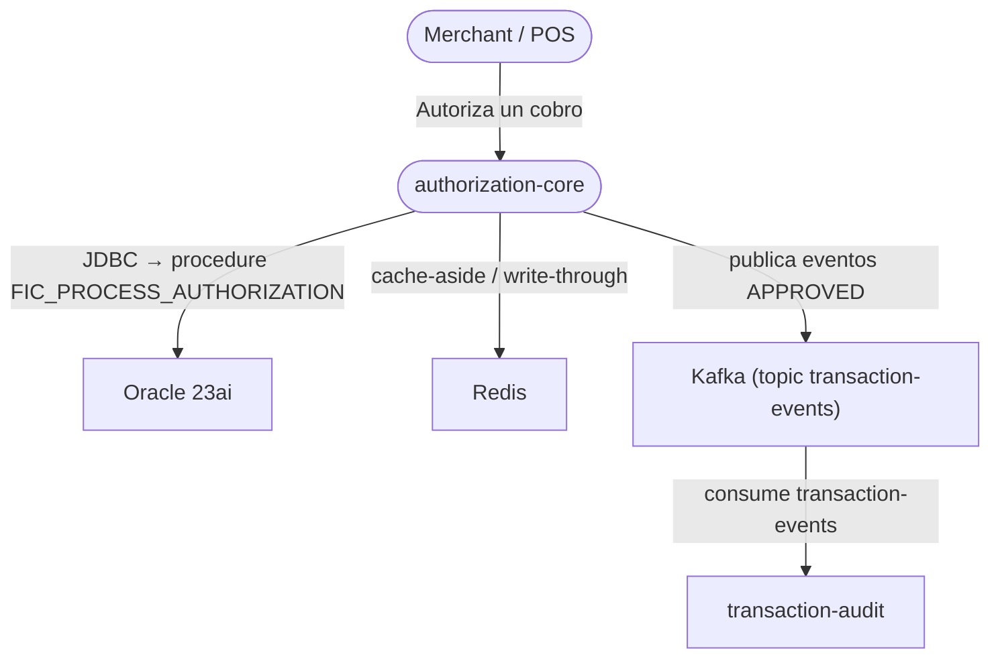
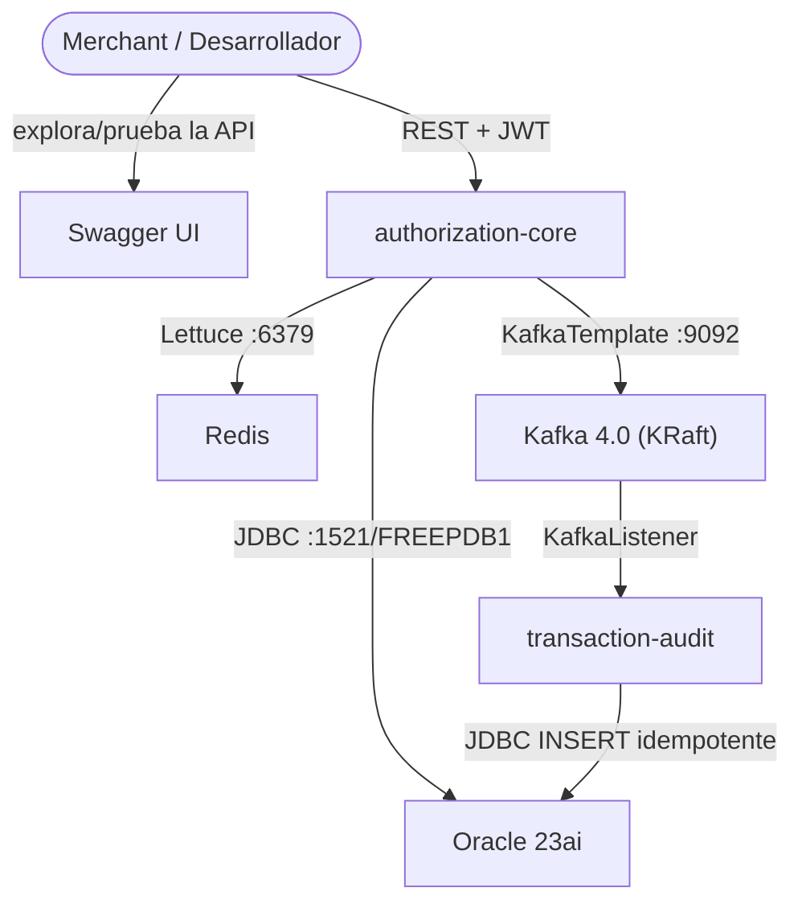
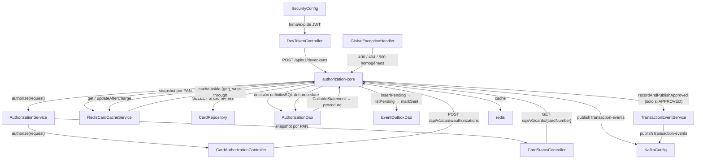

# Diagramas C4 — FICARD

Modelo arquitectónico en 3 niveles (C4: Contexto → Contenedores → Componentes), renderizado con **sintaxis Mermaid básica** (compatible con GitHub).

---

## Nivel 1 — Contexto del sistema

> La vista que aclara el ALCANCE: quién usa el sistema y qué sistemas externos lo rodea.

---

## Nivel 2 — Contenedores

> La vista de DEPLOYMENT: los procesos/apps y los mecanismos de comunicación.

---

## Nivel 3 — Componentes (zoom sobre authorization-core)

> La vista de COMPONENTES: el inside del core. Ésta es la que hace legible el flujo interno durante el code review.

---

### Cómo leerlos en la demo

1. **Contexto**: si al entrevistador le importa el alcance y los actores.
2. **Contenedores**: la vista que conecta con el `docker-compose.yml` (cada contenedor = un servicio del compose).
3. **Componentes**: la vista que se usa para el walkthrough del código (el flujo del service está en las `Rel` de arriba, en orden de ejecución).