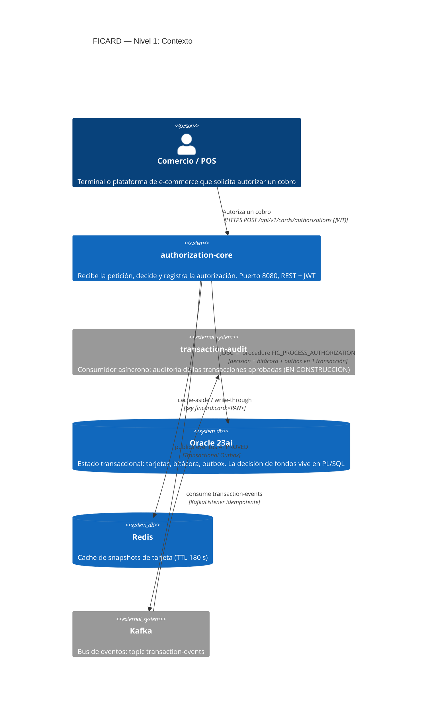
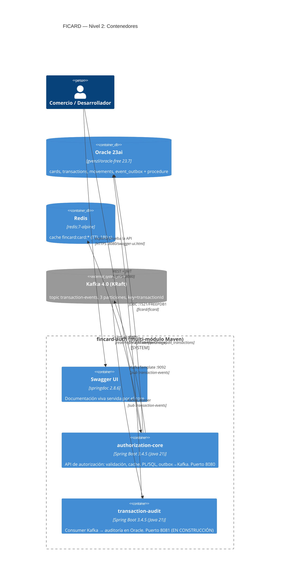

# Diagramas C4 — FICARD

Modelo arquitectónico en 3 niveles (C4: Contexto → Contenedores → Componentes),
renderizado con [Mermaid's C4 syntax](https://mermaid.js.org/syntax/c4c.html)
(GitHub lo pinta nativo en los .md).

---

## Nivel 1 — Contexto del sistema

> La vista que aclara el ALCANCE: quién usa el sistema y qué sistemas externos
> lo rodean. Nota el `transaction-audit` como sistema *en construcción*.



---

## Nivel 2 — Contenedores

> La vista de DEPLOYMENT: los procesos/apps y los mecanismos de comunicación.
> Los números reflejan los puertos reales del local (y del futuro compose).



---

## Nivel 3 — Componentes (zoom sobre `authorization-core`)

> La vista de COMPONENTES: el inside del core. Ésta es la que hace legible el
> flowo interno durante el code review.

```mermaid
C4Component
    title authorization-core — Nivel 3: Componentes

    Container(core, "authorization-core", "", "") {
        Component(authzCtrl, "CardAuthorizationController", "@RestController", "POST /api/v1/cards/authorizations → @Valid DTO → service")
        Component(statusCtrl, "CardStatusController", "@RestController", "GET /api/v1/cards/{cardNumber} (snapshot, 404 si no existe)")
        Component(devTokCtrl, "DevTokenController", "@RestController @Profile('local')", "POST /api/v1/dev/tokens — emisor HS256 de desarrollo")

        Component(security, "SecurityConfig", "@Configuration", "SecurityFilterChain: firma/exp de JWT (HS256), paths públicos anomalía")
        Component(exceptionAdvice, "GlobalExceptionHandler", "@RestControllerAdvice", "400 / 404 / 500 homogéneos (ErrorResponse)")

        Component(service, "AuthorizationService", "@Service", "Orquestador: cache → checks optimistas → procedure → cache write-through → evento")
        Component(cache, "RedisCardCacheService", "@Service", "cache-aside (get), write-through (updateAfterCharge); degrada si Redis cae")
        Component(cardRepo, "CardRepository", "@Repository", "SELECT tarjetas por PAN (JdbcTemplate)")
        Component(dao, "AuthorizationDao", "@Repository", "CallableStatement → FIC_PROCESS_AUTHORIZATION (7 IN / 5 OUT)")
        Component(outboxDao, "EventOutboxDao", "@Repository", "insertPending / markSent / listPending (JdbcTemplate)")
        Component(eventSvc, "TransactionEventService", "@Service @Scheduled", "Toma PENDING del outbox y los publica a Kafka; reintento cada 10 s")
        Component(kafkaCfg, "KafkaConfig", "@Configuration", "Topic transaction-events como código (3 quepartes, 1 réplica)")

        Rel(authzCtrl, service, "authorize(request)")
        Rel(statusCtrl, cache, "snapshot por PAN")
        Rel(service, cache, "get / updateAfterCharge")
        Rel(service, cardRepo, "SELECT si cache-miss")
        Rel(service, dao, "decisión definitiva")
        Rel(service, eventSvc, "recordAndPublishApproved (solo si APPROVED)")
        Rel(eventSvc, outboxDao, "insertPending → listPending → markSent")
        Rel(dao, db, "SQL del procedure")
        Rel(cache, redis, "cache")
        Rel(eventSvc, kafka, "publish transaction-events")
        Rel(security, devTokCtrl, "debe emitir JWT con la misma secret que valida")
    }
```

---

### Cómo leerlos en la demo

1. **Contexto**: si al entrevistador le importa el alcance y los actores
2. **Contenedores**: la vista que conecta con el `docker-compose.yml` (Fase 6: cada contenedor aquí = un servicio del compose)
3. **Componentes**: la vista que se usa para el walkthrough del código (el flujo del service está en «Rel» de arriba, en orden de ejecución)
